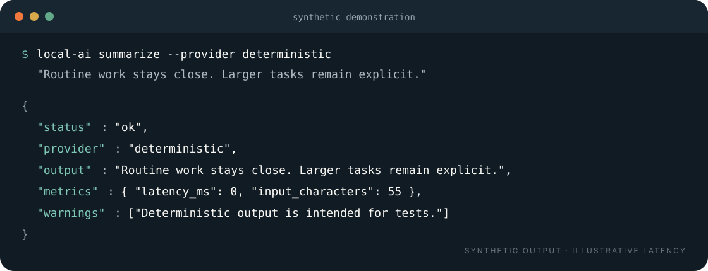
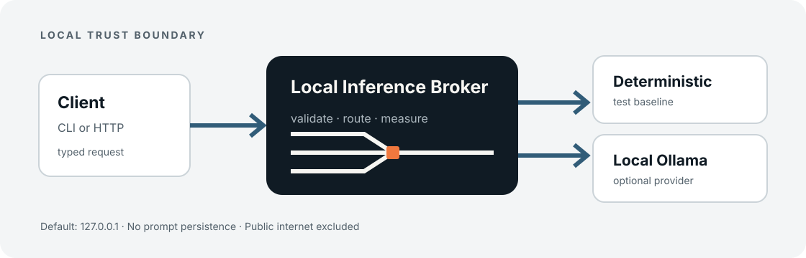

<p align="center">
  
</p>

<p align="center"><strong>Keep routine inference close. Send less noise upstream.</strong></p>

<p align="center">
  <a href="README.pt.md">Português</a> ·
  <a href="docs/architecture.md">Architecture</a> ·
  <a href="SECURITY.md">Security</a>
</p>

> **Prototype v0.1 · synthetic examples only.** This repository is prepared for public review but is not a public internet service.

Local Inference Broker is a small Python service that places one typed contract in front of local inference providers. It runs deterministic baselines or Ollama locally and reports what happened without persisting prompt or response content.



## What it proves

- A client can submit `ask`, `summarize`, or `extract` through one API contract.
- Routine work can be routed to deterministic tools or a locally running Ollama instance.
- Every response identifies the provider and reports measured latency and character counts.
- Non-loopback serving is rejected unless bearer authentication is configured.

Character counts are measurements, not token estimates. No claim is made about cost, quality, privacy outside the broker process, or performance on different hardware.

## Architecture



The broker is independent: it imports no application code and contains no private examples. See [the architecture notes](docs/architecture.md) for trust boundaries and failure behavior.

## Quick start

Requires Python 3.11–3.13.

```bash
python3.11 -m venv .venv
source .venv/bin/activate
python -m pip install -e '.[dev]'

# Terminal 1
local-ai serve

# Terminal 2: deterministic, synthetic connectivity check
local-ai summarize --provider deterministic \
  "Routine work stays close. Larger tasks remain an explicit decision."
```

Optional Ollama integration uses the locally configured Ollama API:

```bash
export LIB_OLLAMA_MODEL='qwen2.5:7b'
local-ai ask "Return one concise sentence."
```

`auto` currently selects Ollama. The deterministic provider must be selected explicitly when Ollama is unavailable.

## API contract

`GET /health` returns service status and version. `POST /v1/run` accepts:

```json
{
  "task": "summarize",
  "input": "Synthetic text only.",
  "provider": "deterministic",
  "model": null,
  "timeout_seconds": 30
}
```

Responses include a request ID, provider, model, output, optional structured data, warnings, latency, input/output character counts, and a measured compression ratio.

## Network and privacy boundary

- Default binding: `127.0.0.1:8787`.
- A non-loopback binding requires `LIB_BEARER_TOKEN`.
- CLI authentication uses `LOCAL_AI_TOKEN`; the values must match for LAN use.
- Requests and outputs are not persisted or intentionally logged.
- `.env`, logs, caches, build outputs, and local runtime files are excluded from Git.
- The broker must not be exposed directly to the public internet.

Review [SECURITY.md](SECURITY.md) before changing the network boundary.

## Development

```bash
ruff check .
mypy src tests
pytest
python -m build
local-ai --help
```

See [CONTRIBUTING.md](CONTRIBUTING.md) for the complete release checks.

## Deliberate exclusions

No agents, long-term memory, RAG, vector database, cloud orchestration, public server, custom frontend, or background prompt storage are part of v0.1.

## Status and roadmap

- **v0.1:** deterministic baseline, Ollama provider, typed HTTP API, CLI, network guardrail.
- **Next evidence:** measured local demonstrations across documented hardware and models.
- **Later:** additional providers only after explicit privacy and threat-boundary review.

Released under the [MIT License](LICENSE). Brand assets are documented in [the direction paper](docs/design-direction.md).
