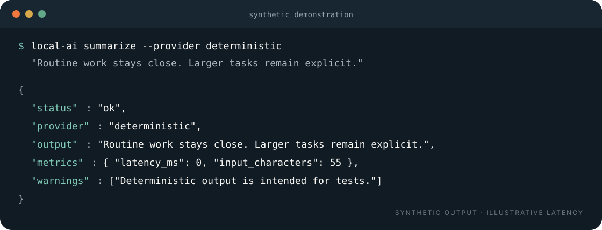

<p align="center">
  
</p>

<p align="center"><strong>Mantém a inferência rotineira por perto. Envia menos ruído.</strong></p>

<p align="center">
  <a href="README.md">English</a> ·
  <a href="docs/architecture.md">Arquitetura</a> ·
  <a href="SECURITY.md">Segurança</a>
</p>

> **Protótipo v0.1 · apenas exemplos sintéticos.** Este repositório está preparado para revisão pública, mas não é um serviço para a Internet pública.

O Local Inference Broker é um pequeno serviço Python que coloca um contrato tipado à frente de fornecedores de inferência local. Executa uma base determinística ou Ollama localmente e relata o resultado sem guardar o conteúdo dos pedidos ou respostas.



## O que demonstra

- Um cliente pode enviar `ask`, `summarize` ou `extract` através do mesmo contrato.
- Trabalho rotineiro pode ser encaminhado para ferramentas determinísticas ou uma instância Ollama local.
- Cada resposta identifica o fornecedor e apresenta latência e contagens de caracteres medidas.
- O serviço recusa escutar fora do computador sem autenticação por token.

As contagens de caracteres são medições, não estimativas de tokens. Não são feitas promessas sobre custo, qualidade, privacidade fora do processo ou desempenho noutro equipamento.

## Início rápido

Requer Python 3.11–3.13.

```bash
python3.11 -m venv .venv
source .venv/bin/activate
python -m pip install -e '.[dev]'

# Terminal 1
local-ai serve

# Terminal 2: teste determinístico com conteúdo sintético
local-ai summarize --provider deterministic \
  "O trabalho rotineiro fica perto. Tarefas maiores continuam uma decisão explícita."
```

`auto` seleciona atualmente o Ollama. O fornecedor determinístico deve ser escolhido explicitamente quando o Ollama não estiver disponível.

## Limite de rede e privacidade

- Endereço predefinido: `127.0.0.1:8787`.
- Escutar fora do computador requer `LIB_BEARER_TOKEN`.
- A CLI usa `LOCAL_AI_TOKEN`; os valores devem coincidir para utilização em LAN.
- O broker não guarda nem regista intencionalmente pedidos ou respostas.
- O serviço nunca deve ser exposto diretamente à Internet pública.

Consulta [SECURITY.md](SECURITY.md) antes de alterar o limite de rede.

## Desenvolvimento

```bash
ruff check .
mypy src tests
pytest
python -m build
local-ai --help
```

## Exclusões deliberadas

Agentes, memória de longo prazo, RAG, bases vetoriais, orquestração cloud, servidor público, frontend e armazenamento de prompts não fazem parte da v0.1.

Licença [MIT](LICENSE). A identidade está documentada no [documento de direção](docs/design-direction.md).
